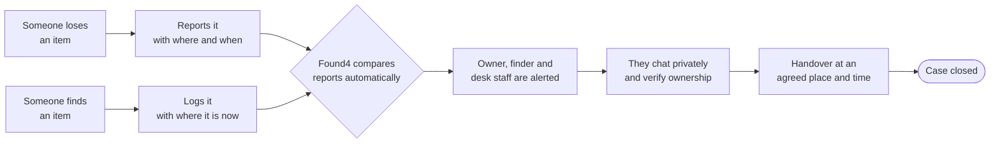
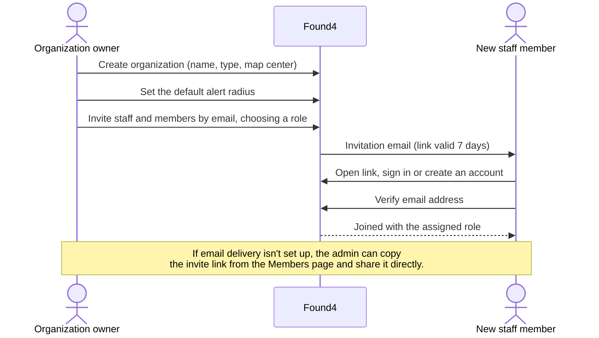
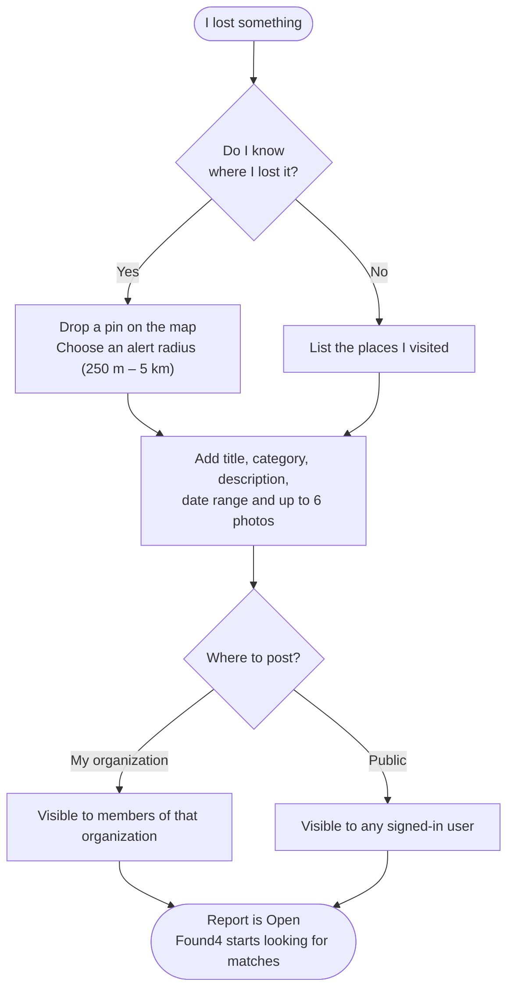
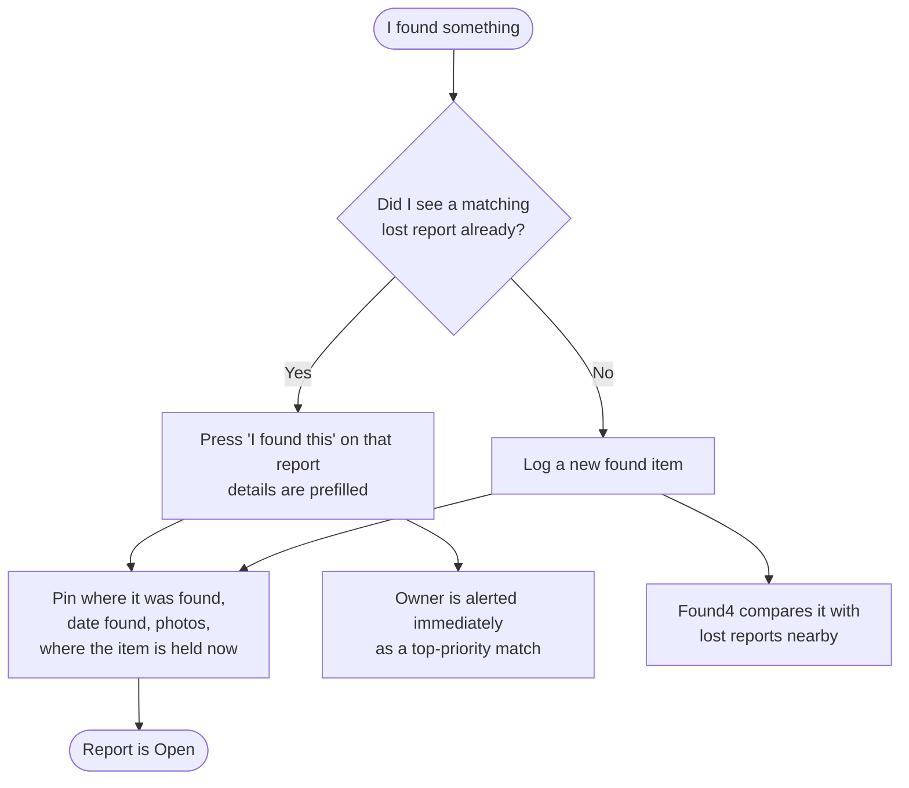
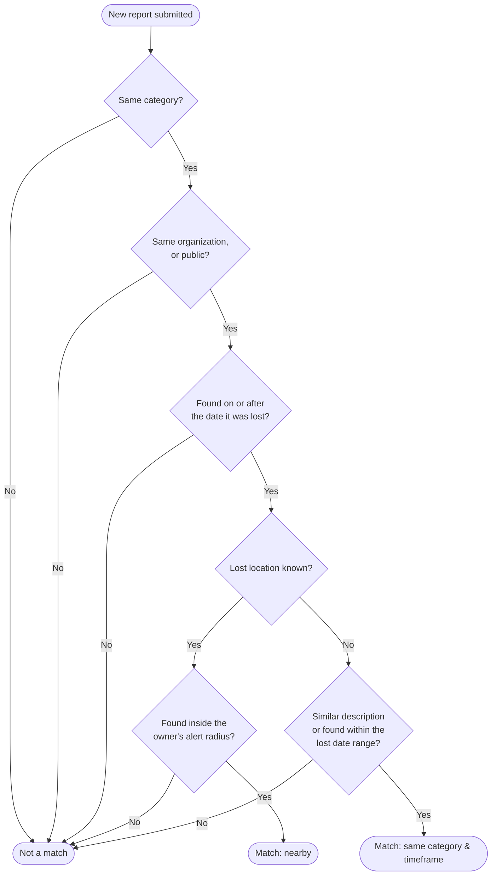
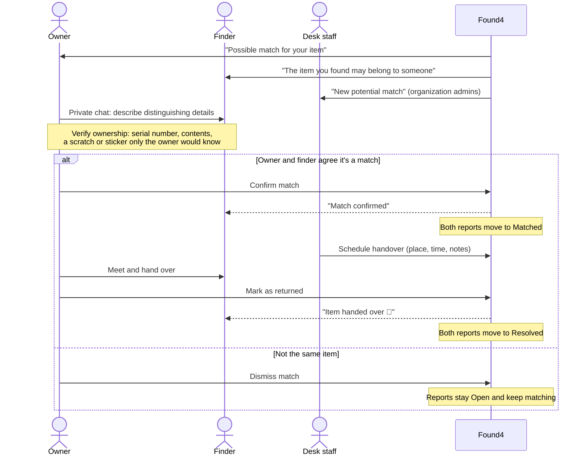
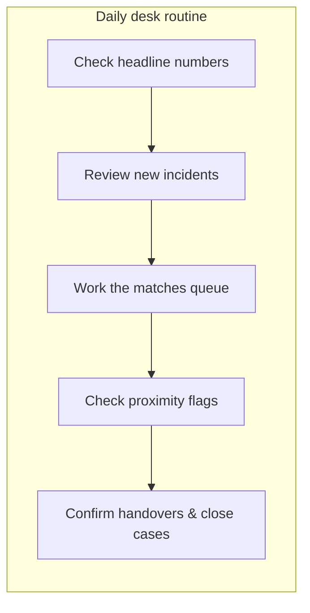
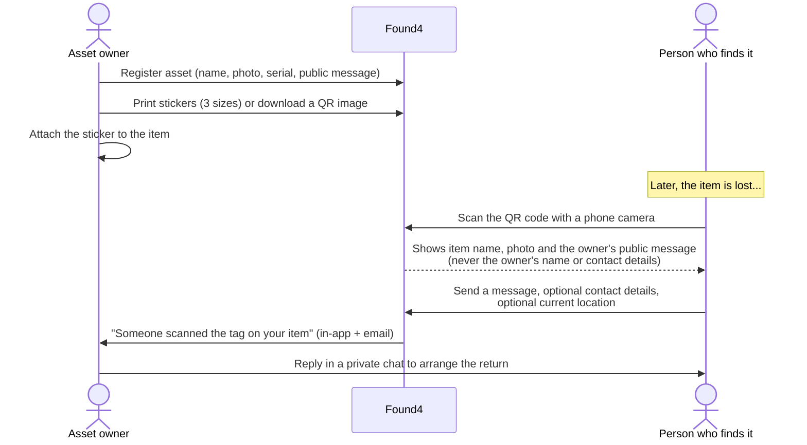
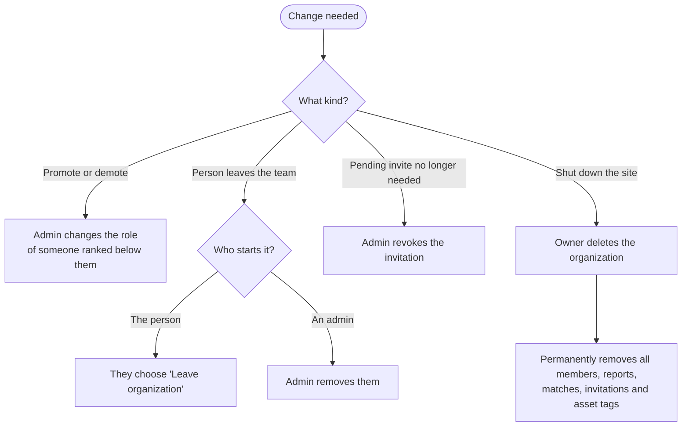
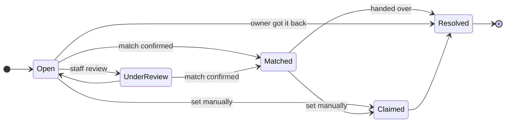

# Found4 — Business Workflows

This document describes how Found4 works from a business and operations point of view: who takes part, what each person does, what the system does for them, and the rules that apply. It is meant for operations leads, lost-and-found desk staff, organization admins and product stakeholders.

For the technical version (functions, collections, security rules) see [WORKFLOWS.md](WORKFLOWS.md).

## Contents

1. [What Found4 does](#1-what-found4-does)
2. [Who is involved](#2-who-is-involved)
3. [Organization onboarding](#3-organization-onboarding)
4. [Reporting a lost item](#4-reporting-a-lost-item)
5. [Logging a found item](#5-logging-a-found-item)
6. [Matching & alerts](#6-matching--alerts)
7. [Verification & return (handover)](#7-verification--return-handover)
8. [Desk operations: the command center](#8-desk-operations-the-command-center)
9. [QR asset tag program](#9-qr-asset-tag-program)
10. [Team management & offboarding](#10-team-management--offboarding)
11. [Who gets told what](#11-who-gets-told-what)
12. [Status glossary](#12-status-glossary)
13. [Business rules & policies](#13-business-rules--policies)
14. [Known limitations](#14-known-limitations)

---

## 1. What Found4 does

Found4 replaces the paper logbook and the "check the box behind the desk" routine at campuses, offices, transit hubs, venues and hotels.

**Core value:**

- **Faster returns.** Owners get alerted when a matching item is logged near where they lost theirs, instead of having to call around.
- **Less desk workload.** Matching is automatic, and staff work from one live screen instead of a logbook.
- **Privacy.** Owners and finders talk through in-app chat without swapping phone numbers. QR tag owners are never identified to the finder.
- **Accountability.** Every status change is recorded with who made it and when.

---

## 2. Who is involved

| Role | Who they are | What they do in Found4 |
| --- | --- | --- |
| **Owner** (of a lost item) | Anyone with an account | Reports the loss, reviews suggested matches, chats with the finder, confirms the return |
| **Finder** | Anyone with an account | Logs a found item and where it's being held, chats with the owner |
| **Anonymous finder** | A member of the public who scans a QR tag | Sends the owner a message or location without creating an account |
| **Member** | Someone who belongs to an organization | Reports and browses the organization's lost & found items |
| **Staff** | Lost-and-found desk, security, front office | Triages reports, links and confirms matches, schedules handovers |
| **Admin** | Department or site manager | Everything staff can do, plus inviting people, managing roles and editing settings |
| **Organization owner** | The person who set the organization up | Everything admins can do, plus managing admins and deleting the organization |

Roles are ranked **Owner > Admin > Staff > Member**. People can only manage those ranked below them.

---

## 3. Organization onboarding

An organization (a campus, an office, a station) gets its own private lost & found space. Items reported inside it are only visible to its members.

**Onboarding checklist for a new site**

1. Owner creates the organization and picks its type (campus, office, transit hub, venue, hotel, other).
2. Owner sets the map center and the default alert radius.
3. Owner invites at least one **Admin** and the desk **Staff**.
4. Staff accept their invites and verify their email.
5. Members (students, employees, tenants) are invited as **Member**.
6. Optionally, staff register and tag the organization's equipment (see [§9](#9-qr-asset-tag-program)).

---

## 4. Reporting a lost item

**Tips that improve the chance of a match:**

- Pick the right **category**. Items only match within the same category.
- Use a clear title and specific words in the description ("black leather wallet, red stitching"). When there's no map pin, matching relies on wording and dates.
- A **smaller radius** means fewer, more relevant alerts. A **larger radius** catches items that were moved before being handed in.

---

## 5. Logging a found item

**Good practice for desks:** record the item's current location precisely (for example "Security office, Building A, shelf 3") so whoever hands it over can find it.

---

## 6. Matching & alerts

Found4 checks for matches **automatically**, as soon as a report is submitted.

**How a match is ranked:** closer items and items with more similar descriptions score higher. Each new report creates at most **10** suggestions, best first.

**Four ways a match can come about:**

| Type | How it happens |
| --- | --- |
| Nearby | Found inside the owner's alert radius |
| Same category & timeframe | The owner didn't know the location, but the category, dates or description line up |
| Reported by finder | The finder pressed "I found this" on the owner's report. Always ranked first |
| Linked by staff | Desk staff spotted a likely pair and linked it by hand (see [§8](#8-desk-operations-the-command-center)) |

A match is only a **suggestion**. Nobody's item changes status until someone confirms it.

---

## 7. Verification & return (handover)

**Who can act on a match:** the owner, the finder, and any staff, admin or owner of the organization.

**Handover guidance shown to users:** meet in a public place or at an official lost-and-found desk.

**Recommended desk procedure** (a suggestion, not enforced by the system):

1. Ask the owner for proof of ownership before handing the item over.
2. Record the place and time in the match's handover details.
3. Mark the match as returned straight after the handover, so both reports close.

**Closing without a match:** if an owner gets their item back some other way, they can press **"Got it back"** on their report to close it.

---

## 8. Desk operations: the command center

The command center is the staff workspace for an organization. Staff, admins and the owner can use it.

| Area | What staff do there |
| --- | --- |
| **Headline numbers** | See open and under-review reports, and items returned in the last 30 days |
| **Incidents** | Filter all reports, change a status inline (the reporter is notified), message a reporter |
| **Matches** | Confirm, dismiss or complete matches, and schedule handovers |
| **Proximity flags** | Lost and found items of the same category close to each other that aren't linked yet. One click links them and alerts both people |
| **Live map** | Every active report on a map, with each lost report's alert radius |

**When to use "Under Review":** when staff are actively checking a report (for example, examining an item at the desk). It still takes part in matching.

---

## 9. QR asset tag program

Owners can put a QR sticker on valuables (laptops, bags, keys, equipment). Anyone who finds the item can scan it and reach the owner, without an account and without learning who the owner is.

**Personal vs. organization assets**

| | Personal asset | Organization asset |
| --- | --- | --- |
| Registered by | Any user | Staff or above |
| Managed by | The owner | The owner and admins |
| Typical use | Personal laptop, keys, bag | Loan laptops, AV equipment, shared tools |

**Privacy promise:** the scan page shows only the item's name, category, photo and the owner's public message. The serial number, notes and the owner's identity are never shown.

**Abuse protection:** a single finder can send at most 10 scan reports per hour. Anything beyond that is discarded.

---

## 10. Team management & offboarding

**Rules**

- Admins can assign Admin, Staff or Member, but only up to their own rank.
- Only the organization owner can manage admins.
- The owner can't leave or be removed. To stop using the organization, the owner deletes it.
- Deleting an organization is **permanent and can't be undone**.

---

## 11. Who gets told what

Everyone gets an in-app notification (with a pop-up if they're online). Email is sent too unless the person has turned email alerts off on their profile page.

| Event | Owner of lost item | Finder | Org admins & owner | Item reporter | Asset owner | Invitee | Email? |
| --- | :-: | :-: | :-: | :-: | :-: | :-: | :-: |
| New possible match | ✔ | ✔ | ✔ | | | | ✔ |
| Match confirmed | ✔ | ✔ | | | | | ✔ |
| Item returned (match completed) | ✔ | ✔ | | | | | ✔ |
| Match dismissed | ✔ | ✔ | | | | | ✘ |
| Staff changed my report's status | | | | ✔ | | | ✔ |
| Someone scanned my QR tag | | | | | ✔ | | ✔ |
| Invited to an organization | | | | | | ✔ | ✔ |

The person who took an action is not notified about their own action.

---

## 12. Status glossary

### Reports (lost and found items)

| Status | Meaning | Still matching? |
| --- | --- | :-: |
| **Open** | Newly reported, waiting for a match | ✔ |
| **Under Review** | Staff are actively looking into it | ✔ |
| **Matched** | A match was confirmed; handover pending | ✘ |
| **Claimed** | Set manually by the reporter or staff when the item has been claimed | ✘ |
| **Resolved** | Case closed; the item is back with its owner | ✘ |

### Matches

| Status | Meaning |
| --- | --- |
| **Pending review** | Suggested by Found4 or linked by staff; nobody has decided yet |
| **Confirmed** | Owner, finder or staff agreed it's the same item |
| **Handed over** | The item was returned. Both reports close as Resolved |
| **Dismissed** | Reviewed and not the same item |

---

## 13. Business rules & policies

| Area | Rule |
| --- | --- |
| Visibility | Organization reports are visible only to that organization's members. Public reports are visible to any signed-in user |
| Cross-matching | Organization reports can match public reports, but never reports from a different organization |
| Self-matching | A person's own lost and found reports never match each other |
| Photos | Up to 6 photos per report, images only, max 10 MB each |
| Alert radius | 250 m, 500 m, 1 km, 2 km or 5 km. The default is 1 km |
| Match limit | At most 10 suggestions per new report |
| Invitations | Valid for 7 days, single use, and must be accepted by the invited email address |
| Joining | Requires a verified email address |
| Status changes | Reporters can set Open, Claimed or Resolved on their own reports. Staff and above can set any status on organization reports |
| Deleting reports | The reporter, or an admin for organization reports. Existing matches are kept for history |
| Audit trail | Every status change records who made it, when, and an optional note |
| QR scans | Anyone can scan without an account. 10 reports per finder per hour |
| Email opt-out | Each user can switch off email alerts. In-app alerts always arrive |

---

## 14. Known limitations

- **Matching happens once, when a report is submitted.** Editing a report later (changing the pin, category or radius) doesn't trigger a new search. Desk staff should check **Proximity flags** in the command center to catch these pairs.
- **"Claimed" is never set automatically.** Completing a handover moves reports straight to **Resolved**. The README currently says *Claimed*, which doesn't match how the app behaves.
- **Email depends on setup.** If email delivery isn't configured, in-app alerts still work, and admins can share invite links manually.
- **Deleting an organization is permanent.** Export or record anything you need before deleting.
